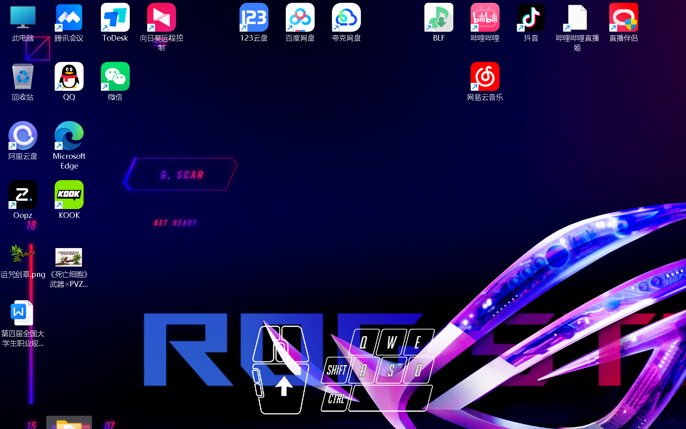
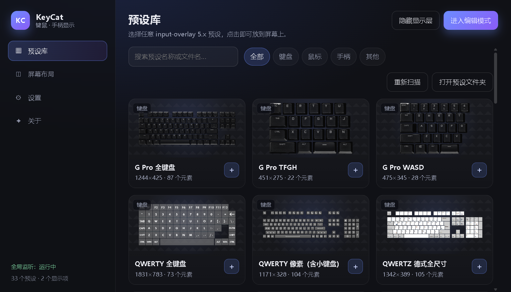
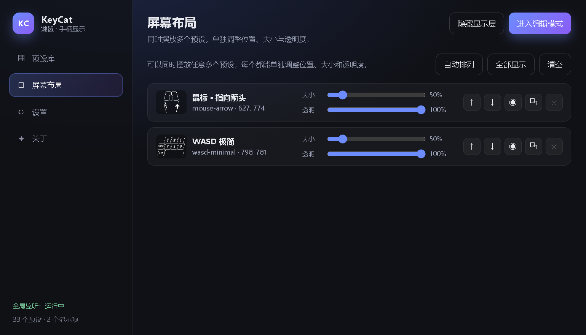

# KeyCat · 桌面键鼠 / 手柄显示

仿 [BongoCat](https://github.com/ayangweb/BongoCat) 的桌面输入显示工具，内置 **input-overlay 5.0.5 全部预设**（另外补了 4 个换色版本，共 33 个），并且支持**在桌面上同时摆放任意多个预设**——键盘、鼠标、手柄可以一起显示，各自独立调整位置、大小和透明度。



<p align="center"></p>
<p align="center"></p>

## 功能

- **实时显示**：全局键盘 / 鼠标按键、滚轮、鼠标移动（光点或箭头）、手柄按键 / 摇杆 / 扳机 / 十字键。
- **多预设同屏**：同一屏幕上可以放任意多个预设，布局、缩放、透明度、层叠顺序都能单独调，全部保存在配置里。
- **33 个内置预设**：input-overlay 5.0.5 的 29 个预设全覆盖，另外提供 DualSense 黑 / 亮白、SNES 备选、Switch Pro 喷射战士四个配色变体。
- **透明置顶覆盖层**：无边框、始终置顶、默认鼠标穿透，不挡日常操作。
- **编辑模式**：拖动移动、滚轮 / 右下角手柄缩放、方向键微调、`Del` 删除、`Esc` 退出，带网格辅助线。
- **演示模式**：自动模拟按键与鼠标移动，方便预览预设效果（没接键鼠 / 录素材时很有用）。
- **托盘常驻**：关掉设置窗口后仍在托盘后台运行。
- **开机自启**、全局快捷键、透明度 / 刷新率 / 鼠标灵敏度与死区等设置。
- **可扩展**：直接把新的 input-overlay 5.x 预设文件夹丢进 `presets/` 或用户预设目录，重启（或点「重新扫描」）就会自动出现。

## 下载

Windows 10/11 x64，绿色免安装（约 153 MB，未签名，首次运行 SmartScreen 可能提示「更多信息 → 仍要运行」）：

**[⬇ KeyCat-1.0.1-win-x64.zip](https://github.com/ZHIZHU4410/KeyCat/releases/download/v1.0.1/KeyCat-1.0.1-win-x64.zip)**

用法：

1. 解压到任意目录（例如 `D:\KeyCat`），双击 `KeyCat.exe` 就能直接用；
2. 想要开始菜单 / 桌面快捷方式，双击压缩包里的 **`install.cmd`**，它会复制到 `%LOCALAPPDATA%\Programs\KeyCat`、创建快捷方式，并在「应用和功能」里注册卸载项；
3. 卸载：双击安装目录里的 `uninstall.cmd`，或用系统「应用和功能」。

> 为什么不是 NSIS 安装包：electron-builder 打出来的 NSIS 安装器在部分 Windows 环境（含本机）会直接报 `Error writing temporary file` 而起不来，而同样的代码用普通 NSIS 脚本打包则正常，属于该模板的环境兼容问题。为了避免大家卡在安装器上，改用 ZIP + 安装脚本，功能一致（快捷方式、卸载项都有）。

## 从源码运行

需要 Node.js 18+。

```bash
npm install
npm start
```

首次启动会在屏幕下方中间放好「鼠标箭头 + WASD 极简」两个预设，托盘里会有 KeyCat 图标。

打包相关：

```bash
npm run dist        # 免安装目录 dist/win-unpacked
npm run pack        # 免安装目录 + dist/KeyCat-<版本>-win-x64.zip（含 install.cmd）
npm run dist:setup  # NSIS 安装包（部分环境会报 temp 错误，见上）
```

> 国内网络如果 Electron 下载慢，可以先设置镜像再安装：
> `set ELECTRON_MIRROR=https://npmmirror.com/mirrors/electron/`

## 使用

| 操作 | 说明 |
| --- | --- |
| `Ctrl + Alt + E` | 进入 / 退出编辑模式 |
| `Ctrl + Alt + H` | 显示 / 隐藏覆盖层 |
| `Ctrl + Alt + S` | 打开设置窗口 |
| 拖动 | 编辑模式下按住预设拖动（`Shift` 吸附 20px） |
| 滚轮 | 编辑模式下缩放光标下的预设 |
| 方向键 | 微调 1px（`Shift` 10px） |
| `Del` | 删除选中的预设 |
| `Esc` | 退出编辑模式 |

设置窗口分四个页签：

- **预设库**：搜索、按键盘 / 鼠标 / 手柄筛选，点卡片右下角 `＋` 就放到屏幕上（可以重复添加同一个预设，例如两个键盘）。
- **屏幕布局**：查看当前所有显示项，逐项调大小 / 透明度 / 层叠顺序，复制、隐藏、删除，一键「自动排列」。
- **设置**：鼠标穿透、始终置顶、全局不透明度、刷新率、网格、演示模式、鼠标灵敏度 / 死区、开机自启、预设目录。
- **关于**：版本与致谢。

## 内置预设

| 分类 | 预设 |
| --- | --- |
| 键盘 | G Pro 全键盘 / TFGH / WASD、QWERTY 全键盘、QWERTY 像素（含小键盘）、QWERTZ 德式全尺寸（2 套）、SC6 对战键盘、WASD 极简 / 完整、WASD 扩展数字区（标准 / 精简 / 红色）、WASD 粉色、YGHJ 极简 |
| 鼠标 | 位移光点、指向箭头、无位移、红点、粉色、罗技 G502 X |
| 手柄 | 通用手柄、DualSense（白 / 黑 / 亮白）、GameCube、SNES（2 套）、NES、Switch Pro（经典 / 喷射战士）、街机摇杆、Hitbox |

## 添加自己的预设

input-overlay 的预设就是一个 layout JSON 加一张 PNG 图集。把整个文件夹放进去即可：

```
presets/
└─ 我的键盘/
   ├─ my-keyboard.json
   └─ my-keyboard.png
```

- 内置目录：`<项目>/presets`（打包后不再可写，只读）
- 用户目录：设置窗口里点「用户目录」会打开（Windows 上一般是 `%APPDATA%\KeyCat\presets`）
- 图集查找顺序：同名 `.png` → 同文件夹名 `.png` → 文件夹里唯一的 PNG
- 想给同一份 layout 换配色，可以在 `preset-meta.json` 里再写一条，指向同一份 JSON、不同 PNG

格式细节见 [docs/PRESET_FORMAT.md](docs/PRESET_FORMAT.md)。

## 项目结构

```
src/
  main/          主进程：窗口、托盘、IPC、配置、全局钩子、预设扫描
  preload/       contextBridge 暴露的 window.keycat API
  renderer/
    overlay.mjs  透明覆盖层：多实例渲染、编辑模式交互、演示模式
    settings.*   设置窗口（原生 HTML/CSS/JS，无框架）
    engine/      预设渲染引擎（纯逻辑，可被 Node 直接复用）
presets/         内置预设（layout JSON + PNG 图集）
preset-meta.json 预设清单（名称、分类、图集）
scripts/         预设校验、离屏预览、CDP 冒烟测试
docs/            预设格式说明
```

## 开发脚本

```bash
npm run check     # 校验全部预设：字段、元素类型、帧是否越界
npm run preview -- --preset=wasd-minimal --out=.preview/wasd.png --keys=16,30,57
npm run preview -- --preset=gamecube --out=.preview/gc.png --pad
```

`scripts/` 里还有三个开发辅助脚本（需要以 `--remote-debugging-port=9222` 启动）：

```bash
node scripts/ui-smoke.mjs        # 设置窗口交互冒烟测试 + 逐步截图
node scripts/ui-overlay-test.mjs # 覆盖层编辑模式拖动测试
node scripts/debug-cdp.mjs --title="KeyCat 设置" --out=shot.png
```

## 实现说明

- 渲染引擎严格按 input-overlay 5.x 的语义实现：元素类型 `0~9`、图集帧间隔固定 `3px`、按下态在 `v + h + 3`、滚轮 / 手柄编号 / 十字键按 `u + (w+3)*n` 横向排布、扳机支持进度填充（方向 1~4）。
- 如果某个预设缺少某类帧（例如 GameCube 的十字键只有一张图），会回退到基础帧而不是画空白。
- 键码直接用 libuiohook 的 VC 码（`uiohook-napi`），与预设里的 `code` 一一对应，不需要做键盘布局转换。
- 手柄走浏览器 Gamepad API：预设里 SDL 顺序的键码（`0~16`）会转换成 W3C 标准编号，`60416+` 的扩展键码按名字映射。
- 覆盖层是一个全屏透明窗口，所有预设画在同一张 canvas 上，因此同屏放几十个预设也只有一次合成。

## 已知限制

- **手柄需要窗口获得焦点**：Chromium 的 Gamepad API 只在文档获得焦点时刷新，所以显示手柄预设时建议先点一下覆盖层所在屏幕（或配合「鼠标穿透」关掉使用）。
- **独占全屏游戏覆盖**：`alwaysOnTop` 在无边框 / 窗口化全屏下正常，独占全屏（Exclusive Fullscreen）下可能被盖住，建议游戏用无边框窗口。
- **只覆盖主显示器**：当前版本在 Windows 主显示器的工作区铺满，多屏暂时只支持主屏。
- **部分截图工具抓不到透明窗口**：覆盖层用了 DWM 的透明表面（`WS_EX_NOREDIRECTIONBITMAP`），`BitBlt` 类截图 / 某些录屏的「窗口捕获」可能拍不到它；OBS 的显示器采集、窗口采集（Windows 10 2004+）正常。

## 常见问题

**双击后没反应 / 一闪就退？**

先看 `%APPDATA%\KeyCat\startup.log`，正常启动应该能看到 `app ready` 和 `windows + tray ready` 两行。

如果这个文件根本没生成，说明崩在 Electron 起来之前，最常见的原因是**程序所在的文件夹带了附加 ACL 限制**（沙箱目录、云同步目录、被安全软件接管的目录等），Chromium 的 GPU 子进程会被拦掉，日志里表现为 `0x80000003` / `GPU process isn't usable`。解决办法：

1. 优先用安装包，装到 `%LOCALAPPDATA%\Programs\KeyCat`；
2. 或者把绿色版整个文件夹拷到 `D:\KeyCat` 这类普通目录再双击；
3. 临时验证可以用 `KeyCat.exe --no-sandbox` 启动（牺牲渲染进程沙箱，仅建议排障时用）。

程序启动后默认**只有托盘图标**（右下角，可能在 `^` 溢出区里），桌面上会直接出现预设；想看设置就双击托盘图标，或者按 `Ctrl + Alt + S`。

## 许可与致谢

- 预设格式与图集素材来自 [univrsal/input-overlay](https://github.com/univrsal/input-overlay)（GPL-2.0），本程序只做渲染与交互，素材版权归原作者及预设作者所有。
- 交互与视觉灵感来自 [ayangweb/BongoCat](https://github.com/ayangweb/BongoCat)（MIT）。
- 本程序代码以 MIT 许可发布。
